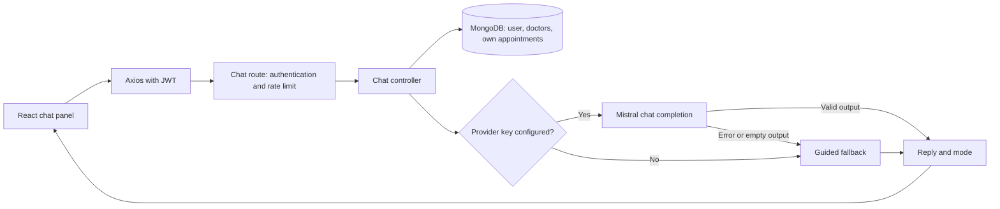

# Engineering guide

Reviewed: 27 October 2026.

## Architecture

The React client uses Axios to call an Express API. JWT middleware establishes the account identity; Mongoose accesses MongoDB. MediMate adds a read-only context and generation path alongside the existing appointment APIs.



The model receives summaries, not database access. The chat controller performs fixed reads before generation. There is no tool dispatcher, execution loop or connection from model output to appointment writes.

## Chat API contract

`POST /api/v1/chat/message` requires `Authorization: Bearer <token>`.

```json
{
  "messages": [
    { "role": "user", "content": "How do I book an appointment?" }
  ]
}
```

Successful response:

```json
{
  "success": true,
  "reply": "Choose a doctor and select a date and time on the booking page.",
  "mode": "guided"
}
```

`mode` is `ai` for a valid provider response and `guided` for the fallback. The frontend currently displays the reply but does not display the mode.

The cleaner accepts only user and assistant messages with string content, keeps the last 10 eligible entries, trims and truncates each content field to 1,000 characters, then removes empty entries. The controller requires a user message after cleaning. Missing/empty valid history returns 400; missing or invalid credentials return 401; rate limiting returns 429. Database and unexpected controller errors pass to the shared error handler.

Known contract gap: `messages` is assumed to be an array. Explicit `null`, an object or a string can trigger an exception rather than a deliberate validation response. Missing `messages` defaults to an empty array. Add request schema validation before exposing broader agent inputs.

## Context construction

Database reads run concurrently:

| Source | Filter and limit | Used in model prompt |
| --- | --- | --- |
| User | Authenticated ID | Name; role flags are selected but not used in the prompt |
| Doctors | Approved status, limit 20, no explicit sort | Names, specialization, experience, fee and working hours |
| Appointments | Authenticated user ID, descending slot, limit 10 | Doctor name, display date, time and status |

The appointment query selects the embedded doctor snapshot, but only its name enters the model summary. Avoid expanding the provider payload to full account or appointment documents.

The prompt asks for replies under 140 words. The provider call uses temperature 0.3 and `maxTokens: 300`; there is no post-generation word-count enforcement. The default model identifier is `mistral-medium-latest`, configurable through the environment.

## Runtime configuration

| Variable | Purpose |
| --- | --- |
| `PORT` | API port; defaults to 8080 |
| `NODE_MODE` | Runtime/logging mode; `test` disables Morgan |
| `MONGO_URL` | MongoDB connection string |
| `JWT_SECRET` | JWT signing and verification secret |
| `MISTRAL_API_KEY` | Optional backend-only provider credential |
| `MISTRAL_MODEL` | Optional model identifier |

Do not assume a running health endpoint proves database readiness: `/api/v1/health` returns a static response and database connection failures are logged by `config/db.js`.

## Development and verification

```powershell
Copy-Item .env.example .env
# Configure .env before starting the app.
npm.cmd install
npm.cmd install --prefix client
npm.cmd run dev
```

Run checks relevant to a change:

```powershell
npm.cmd test
npm.cmd test --prefix client -- --watchAll=false --runInBand
npm.cmd run build --prefix client
```

Use `npm` instead of `npm.cmd` on platforms where appropriate. Preserve existing working-tree edits. Do not present a frontend build, authenticated integration flow or provider connection as verified unless it actually ran.

For chat changes, add meaningful coverage for malformed request bodies, user ownership, provider failure and bounded output. Mock the provider for repeatable unit tests; use a separately configured environment for live provider checks.

## Design for a future tool-using assistant

This section is a proposal, not implemented functionality.

1. Extract shared domain services for doctor search, own appointments and availability. Existing HTTP handlers and agent tools should call the same services.
2. Define an allowlist of typed tools such as `searchDoctors`, `listMyAppointments` and `checkAvailability`. Resolve identity on the server; validate all arguments and returned fields.
3. Add a bounded orchestration loop with maximum steps, provider timeouts, tool timeouts, token limits and a per-request cost budget.
4. Add a booking proposal containing doctor ID, date, time and displayed fee. Require explicit user confirmation tied to that exact proposal before a write.
5. Recheck authorization and availability at execution time. Add durable concurrency protection and idempotency before allowing agent-initiated bookings.
6. Return a booking success claim only after the database confirms creation. Record a sanitized audit event with request, tool and result identifiers.

Never execute arbitrary code, shell commands, database queries or URLs supplied by the model. Keep doctor/admin writes outside patient tools. A role-aware UI does not replace server authorization.

## Known engineering work

- Add schema validation for chat bodies and a response when the JWT subject no longer exists.
- Apply deterministic urgent-message handling before provider calls if that behavior must be guaranteed; the current keyword guard runs only in fallback mode.
- Replace aggregate claims about all doctors or appointments with wording that reflects query limits.
- Add explicit context delimiters and robust evaluation for prompt injection in both messages and database text.
- Configure request deadlines and measure response latency, token usage and fallback frequency.
- Review third-party data handling, logging and retention before using real patient information.
- Protect booking against simultaneous conflicting writes: the current read-then-insert flow has no atomic overlap reservation.
- Define an explicit appointment timezone before supporting users across regions.

See [the detailed report](AGENTIC_AI_REPORT.md) for current validation evidence and staged acceptance criteria.
